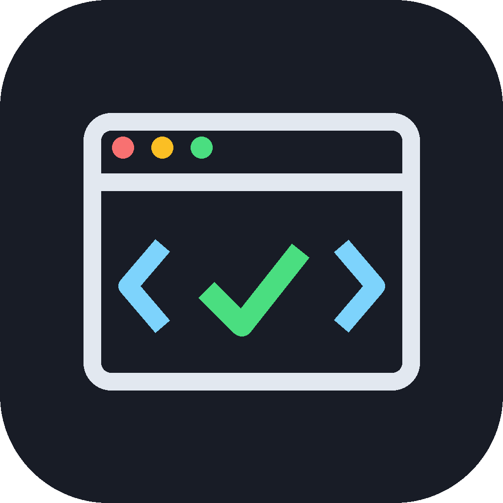

<p align="center"></p>

# frontend-toolkit

A [Claude Code](https://code.claude.com) plugin for React frontends. It gives Claude two read-only
specialists, one for code review and one for UI verification in a real browser, plus a Stop hook
that won't let a UI change end with "it compiles" as the only proof.

| | What | Needs |
| --- | --- | --- |
| **Agent** | `frontend-reviewer`: severity-graded review of a frontend diff | nothing |
| **Agent** | `ui-verifier`: checks the running app against a Figma node or named criteria | a browser MCP; Figma MCP for design-diff |
| **Hook** | `Stop` gate: asks for a browser screenshot after UI files change | bash |
| **Hook** | PR gate (opt-in): blocks `gh pr create` until `frontend-reviewer` has run on the branch | bash, git |
| **Skills** | implementation, architecture, review, a11y, performance and verification guides | nothing |

## Install

```
/plugin marketplace add WiktorSmura/claude-frontend-toolkit
/plugin install frontend-toolkit@frontend-toolkit
```

Restart Claude Code, then check `/hooks` for a `Stop` entry from `frontend-toolkit`.

## First use (30 seconds)

On a branch with frontend changes, ask:

> Use the frontend-toolkit:frontend-reviewer agent to review my changes against main.

You get findings graded critical / warning / suggestion, each with `file:line` and a concrete fix,
then APPROVE or REQUEST CHANGES. The reviewer runs your repo's typecheck, lint and test commands
instead of re-reviewing what they already catch. It spends its attention on what tools can't see:
logic in the wrong layer, server data copied into client state, missing loading and error states,
effect misuse, accessibility, and drift from your documented conventions.

## The agents

**`frontend-reviewer`** reads your `CLAUDE.md`, in-repo skills and neighbouring code before judging
anything, and treats violations of *your* conventions as findings. It only reports problems it can
tie to user impact or real maintenance cost, so it won't pad the list with taste.

**`ui-verifier`** has two modes:

- **design-diff**: exports the Figma node, captures the same state in the app, and compares
  screenshots *and* computed styles (±2px tolerance, exact token colours). Verdict PASS or FAIL.
- **visual-check**: no design needed. It states the criteria first ("the dialog title doesn't wrap
  at 1280px"), then reports each one as MET or NOT MET with evidence.

Every report ends with `Covered:` and `Not verified:` lines, so gaps are stated rather than hidden.
The verifier never starts or kills dev servers and never handles credentials: if it hits a login
wall, it asks you to log in. If your repo has its own browser or dev-server skill, the verifier
lets that skill handle ports, login and feature flags.

```
Use the frontend-toolkit:ui-verifier agent: design-diff of the settings dialog at
http://localhost:5173 against <figma-node-url>.
```

## The Stop hook

When Claude is about to finish a turn, the hook checks the session transcript, subagents included.
If `.tsx/.jsx/.vue/.svelte/.astro/.css/.scss` files were edited after the last browser screenshot,
it blocks the stop once with a request: verify in the browser, or say in one line why no user
could see the change.

- Test, spec and story files don't count, and neither do files under `__tests__/`.
- Any tool with "screenshot" in its name or action counts as evidence: Claude in Chrome,
  Playwright, chrome-devtools, Puppeteer, preview tools, or a `screenshot` command run from the
  shell. Figma exports don't count, since they show the design, not the app.
- It fires at most once per edit, so it can't trap Claude in a loop.
- It stays off in React Native, Expo and Electron projects.
- Turn it off with `FRONTEND_TOOLKIT_UI_GATE=off`, globally in `~/.claude/settings.json`
  (`"env": {"FRONTEND_TOOLKIT_UI_GATE": "off"}`) or for one repo in `.claude/settings.local.json`.

## The PR gate (opt-in)

Set `FRONTEND_TOOLKIT_PR_GATE=on` (in `~/.claude/settings.json` under `"env"`, or per repo in
`.claude/settings.local.json`) and `gh pr create` is blocked on any branch whose commits change UI
files, until `frontend-reviewer` has run on that branch.

- When the reviewer finishes, a `SubagentStop` hook writes a marker for the branch inside the git
  directory. The marker is per worktree, never committed, and survives later commits, so fixing
  the findings doesn't need a second review. It records that a review ran, not that it passed.
- It follows a leading `cd <dir> &&` in the command. It's a reminder, not a lock: a
  `gh pr create` hidden inside a script isn't seen, and anything it can't work out (no git, no
  base branch) lets the command through.
- To skip it once, put `FRONTEND_TOOLKIT_PR_GATE=off` in front of the command.

## The skills

| Skill | Load it for |
| --- | --- |
| `using-frontend-toolkit` | Starting frontend work from a plan or orchestrator: stack detection, gates, what to put in subagent prompts |
| `implementing-frontend` | Components, design tokens, Figma-to-code, state placement; `references/overlays-and-layering.md` for dialogs, popovers and overflow |
| `frontend-architecture` | Where logic lives: components, hooks, commands, services, stores; the validated API boundary |
| `reviewing-frontend` | Review criteria (preloaded by `frontend-reviewer`) |
| `ensuring-accessibility` | WCAG 2.1 AA: keyboard, focus, ARIA, contrast |
| `optimizing-frontend` | Slow renders, bundle size, Core Web Vitals, memory leaks |
| `ui-verification` | Evidence contract and report format (preloaded by `ui-verifier`) |

The skills are written for React 19 with Vite, Tailwind 4, shadcn/Radix, TanStack Query, Zustand
and react-hook-form + Zod. They apply library-specific advice only when `package.json` shows the
library is there; on another stack, they keep to the parts that don't depend on it.

Name a skill in a prompt or plan task to load it reliably ("use
`frontend-toolkit:implementing-frontend`"). Claude also picks them up from their descriptions, but
much less reliably: see [Design notes](#design-notes).

## Is it working? Measure it

```
python3 scripts/usage-report.py --since 2026-01-01
```

Reads your Claude Code transcripts (`~/.claude/projects`), locally and read-only, and reports:

- how many sessions edited UI files, and how many of those ended with a browser screenshot after
  the last edit (the same test the Stop gate applies);
- how often each gate blocked;
- which toolkit agents ran and which skills loaded, per project.

Run it before installing to get a baseline, then a few weeks later. If the evidence rate and the
agent runs don't move, the toolkit isn't earning its keep in your setup. Use `--json` for the raw
numbers.

## Your repo wins

Your `CLAUDE.md`, `AGENTS.md`, in-repo skills and existing code override every default here. The
skills and agents look for them first and never "correct" a codebase toward the toolkit's
preferences.

## Design notes

This plugin used to route work to its skills with `SessionStart` and `SubagentStart` notes ("load
skill X when doing Y"). Over a month of real use in a production React codebase, 86 sessions and
203 subagents received those notes, and **none** loaded a skill because of them. What did work was
naming a skill in a prompt, dispatching an agent, and hooks that check results. So 1.0 drops the
routing and keeps those three. Details are in [CHANGELOG.md](CHANGELOG.md).

## Development

```
bash hooks/test-ui-evidence-gate.sh     # Stop gate self-check
bash hooks/test-pr-review-gate.sh       # PR gate self-check
python3 -m unittest discover -s scripts  # usage report self-check
claude plugin validate .                # manifest and structure
claude --plugin-dir .                   # try it without installing
```

**Evals** (`evals/`, run with `claude plugin eval`) check that review requests reach
`frontend-reviewer`, Figma questions reach `ui-verifier`, backend tasks touch neither, and that
the Stop gate fires on a real edit. The whole suite costs about USD 0.25 per run and runs on your
own Claude credential:

```
claude plugin eval . --trust-plugin --no-publish --ablation none --scaffold \
  --allow-tools Edit --model claude-sonnet-5-5
```

CI runs the self-checks and validation on every push, which is free on a public repo. It runs the
evals only when the repo has an `ANTHROPIC_API_KEY` or `CLAUDE_CODE_OAUTH_TOKEN`
(`claude setup-token`) secret.

Works on macOS and Linux. The hook needs only bash, grep, sed and sort.

## License

[MIT](LICENSE). Parts of the skills are adapted from
[TheSoftwareHouse/copilot-collections](https://github.com/TheSoftwareHouse/copilot-collections) (MIT).
